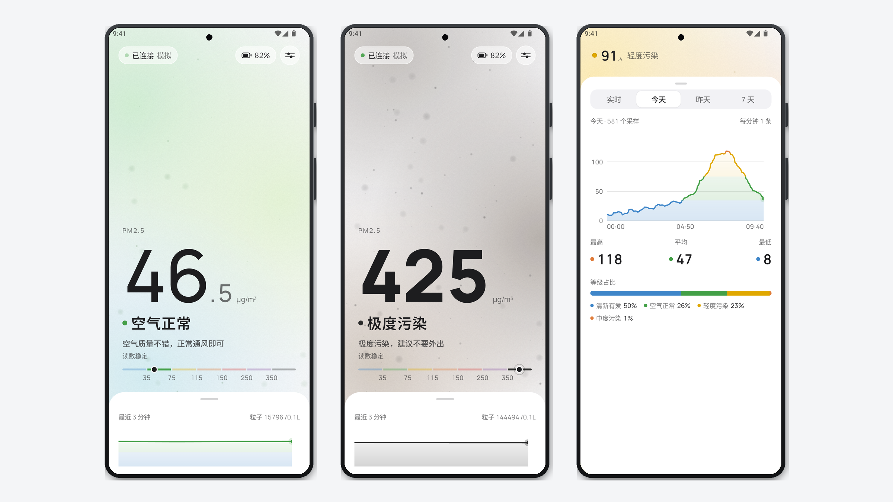
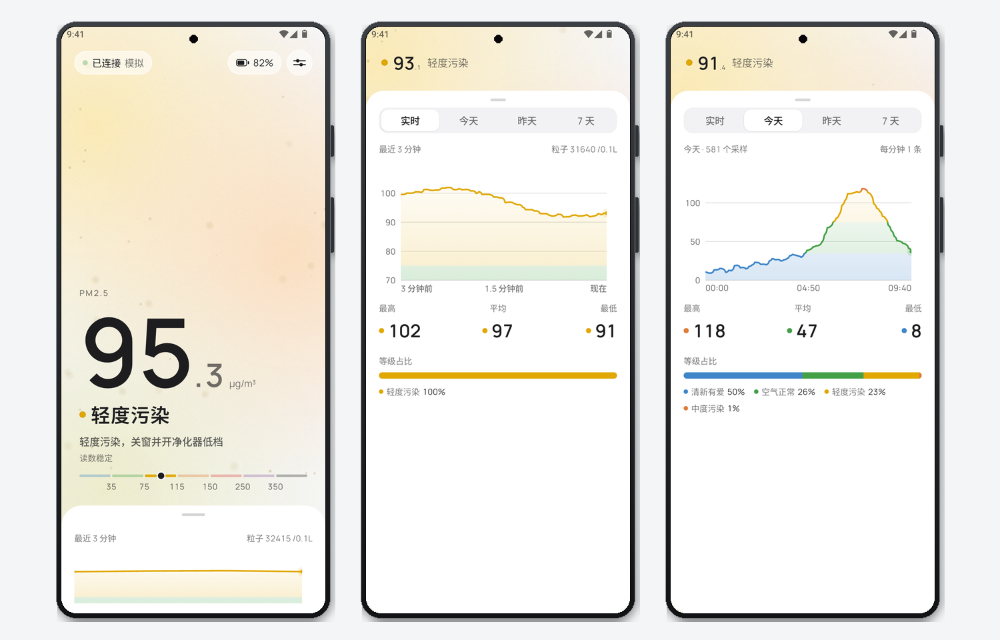
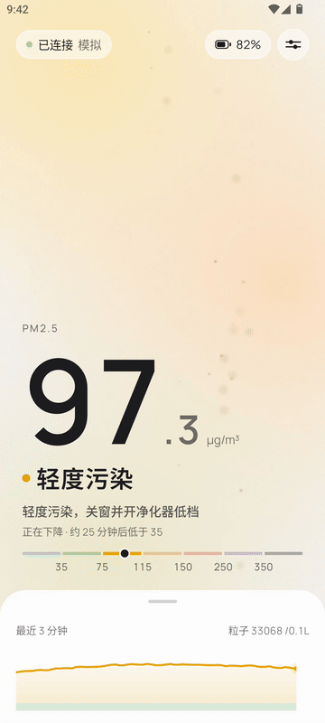

# EMO 空气堡 · 现代客户端

为闲置的 Airburg EMO PM2.5 检测仪重写的 Android 客户端。Android 8.0 起 · 仅支持一代 EMO · 数据只留在本机。

  

十几年前在优酷的科技视频里第一次见到它——那正是国内开始集体关注 PM2.5 的年代。后来厂商转做净化设备，配套 App 停止更新，Android 升级后它再也打不开，就一直在角落里吃灰。最近雾霾又起，想起这台小仪器，恰好 AI 编程已经够用，于是重写了这个客户端。

手边没有设备也可以先装上看看：打开设置里的「模拟数据」，拖动模拟浓度滑杆，七档空气状态都能预览。

## 下载安装

从 [Releases](https://github.com/dexwenway/airburg-emo/releases/latest) 下载最新的 APK 安装。第一次连接需要在系统弹窗里允许蓝牙；Android 8–11 还要授予定位权限并打开系统定位，旧系统的 BLE 扫描依赖它。

## 界面与记录

  

趋势抽屉的三种状态：底部露头、展开后的实时曲线、展开后的今天曲线。

  

**兼容**：Android 8.0 及以上；只兼容一代 EMO，不支持二代 EMO Plus。

## 协议与构建

一代 EMO 的 BLE GATT 协议整理在 [docs/protocol.md](docs/protocol.md)，设备探测脚本见 [tools/](tools/)（`scan_ble.py`、`probe_emo.py`）。

本地构建用 `./gradlew assembleDebug`；发布签名通过 `EMO_RELEASE_*` 环境变量传入，不写进仓库。

本项目是非官方客户端，与 Airburg 及原厂无隶属或授权关系。协议来自原厂 APK 分析与实机读取；设备老化、固件批次差异都可能带来读数偏移，软件按现状提供，读数仅供参考。

代码由 AI 协助完成。[MIT](LICENSE) © 2026 dexwenway
